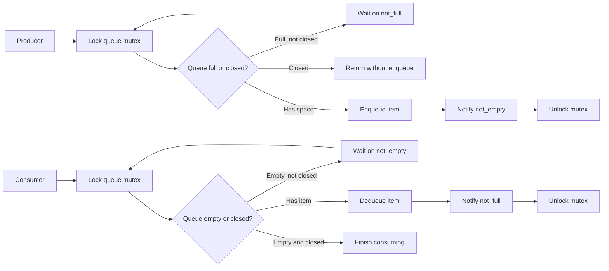
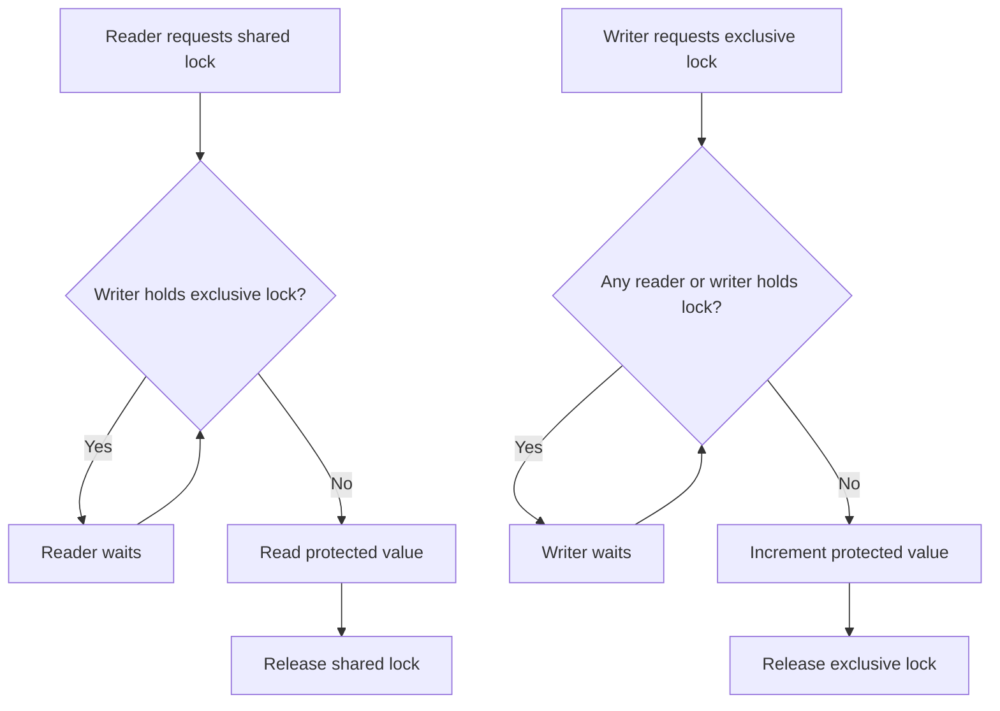
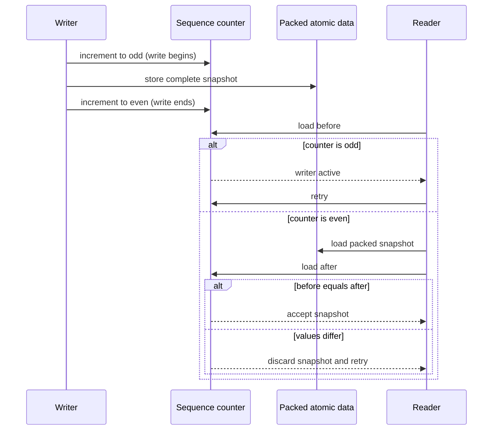
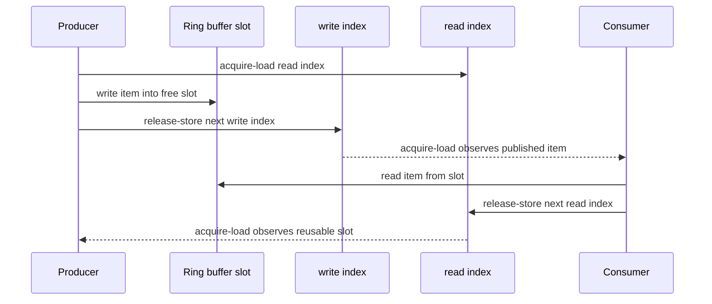

# Synchronization

Synchronization coordinates concurrent execution so shared state remains
correct. Concurrency is about overlapping work; parallelism is about work
running at the same instant on multiple CPUs. Correct synchronization is needed
for both.

## The data-race rule

In C and C++, conflicting unsynchronized accesses to the same memory location,
where at least one access is a write, form a data race. A data race is undefined
behavior in both language memory models. A lock, an atomic operation, or
appropriate message passing must establish the required ordering.

Protect an invariant, not merely an individual variable. Keep the protected
region small, but do not split related state updates across unrelated locks.
Prefer scoped/RAII locking in C++ and a single, consistent lock/unlock path in C.

## Common primitives

| Primitive | Typical use | Important property |
| --- | --- | --- |
| Mutex | Exclusive access to shared state | Usually blocks under contention; ownership matters |
| Semaphore | Resource count or event permits | A counting primitive; it need not have an owner |
| Condition variable | Wait until a predicate changes | Always pair with a mutex and re-check the predicate in a loop |
| Reader-writer lock | Many readers or one writer | Can starve readers or writers depending on implementation/policy |
| Spin lock | Very short critical sections | Busy-waits; never sleep or perform blocking work while holding it |
| Atomic operation | Independent value/state transitions | Does not automatically make a multi-field invariant atomic |
| Seqlock/sequence counter | Readers can retry a consistent snapshot | Readers may starve/retry; writers are serialized |

A semaphore is not simply a mutex with different names: it represents permits
and can be signaled by a different thread. A condition variable is not a lock:
`wait` atomically releases the associated mutex while sleeping, then reacquires
it before returning. Spurious wakeups are permitted, so always use a predicate
loop.

## Choosing an approach

1. Use a mutex for mutable state with multiple related fields.
2. Use a condition variable to sleep until a state predicate becomes true.
3. Use a semaphore when the number of available permits is meaningful.
4. Use a reader-writer lock only when reads dominate and measurements justify it.
5. Use atomics for small, well-defined state transitions and communication.
6. Use spin locks only when critical sections are short and the execution
   environment makes sleeping inappropriate (for example, specific kernel
   contexts).

Do not assume a primitive is fair, lock-free, faster, or starvation-free unless
the relevant API documents that guarantee. Performance depends on the platform,
runtime, contention, and critical-section duration.

## C++ demonstrations

The standalone C++20 programs under [`cpp/`](cpp/) illustrate:

- [`producer_consumer.cpp`](cpp/producer_consumer.cpp): bounded queue using a
  mutex and condition variables.
- [`reader_writer.cpp`](cpp/reader_writer.cpp): concurrent reads and exclusive
  writes using `std::shared_mutex`.
- [`seqlock.cpp`](cpp/seqlock.cpp): a retrying snapshot reader. Payload members
  are packed into one atomic value, so the example remains defined by the C++
  memory model. Sequentially consistent ordering is used for clarity rather
  than maximum performance.
- [`atomic_patterns.cpp`](cpp/atomic_patterns.cpp): a single-producer,
  single-consumer ring buffer using acquire-release publication and reclamation.
  Its ownership model is intentionally limited to exactly one producer and one
  consumer; it is not a general multi-producer queue.

## Design diagrams

The diagrams below correspond to the implementations above. They show the
synchronization decisions, not a guaranteed thread schedule.

### Bounded producer-consumer queue

In [`producer_consumer.cpp`](cpp/producer_consumer.cpp), both queue state and
the `closed` flag are protected by one mutex. The condition-variable waits
release that mutex while a thread sleeps, then reacquire it and re-check the
predicate.



### Reader-writer lock

[`reader_writer.cpp`](cpp/reader_writer.cpp) takes a shared lock for each
snapshot read and an exclusive lock for each increment. Multiple readers can
hold the shared lock together; a writer's exclusive lock excludes both readers
and other writers.



The C++ standard does not promise a particular fairness policy for
`std::shared_mutex`; a workload with sustained contention can affect progress.

### Sequence-counter snapshot (seqlock-style)

[`seqlock.cpp`](cpp/seqlock.cpp) serializes writers with a mutex and uses an
odd/even sequence counter around an atomic packed payload. A reader accepts the
snapshot only if the counter is even and unchanged across its payload load.
Otherwise it retries. This is a C++-memory-model-safe teaching analogue, not a
drop-in kernel seqlock.



### Single-producer, single-consumer atomic ring buffer

[`atomic_patterns.cpp`](cpp/atomic_patterns.cpp) uses two monotonically
increasing indices. The producer's release-store publishes initialized slot
data; the consumer's acquire-load observes that publication. In the other
direction, the consumer releases a slot after reading it, and the producer's
acquire-load observes that the slot can be reused.



This ring buffer is deliberately single-producer/single-consumer: each index
has exactly one writer. It spins with `yield()` when full or empty; production
code may instead need blocking, cancellation, shutdown, and more robust error
handling.

Build any one from the repository root with CMake, for example:

```sh
cmake -S . -B build
cmake --build build --target synchronization_seqlock
./build/synchronization/cpp/synchronization_seqlock
```

## Failure modes to recognize

- **Deadlock:** participants wait forever, often because of inconsistent lock
  ordering. Define a global lock order or use a deadlock-avoiding API.
- **Livelock:** participants keep reacting to one another but make no progress.
- **Starvation:** one participant is repeatedly denied progress.
- **Priority inversion:** a high-priority task waits for a lower-priority task
  that cannot run promptly.

## More introductory examples

For short C++ examples before exploring the APIs in this repository, see
[JohnBlue-git/BasicThreadLock](https://github.com/JohnBlue-git/BasicThreadLock),
including its mutex, spin-lock, condition-variable, semaphore, and
producer-consumer demonstrations.
